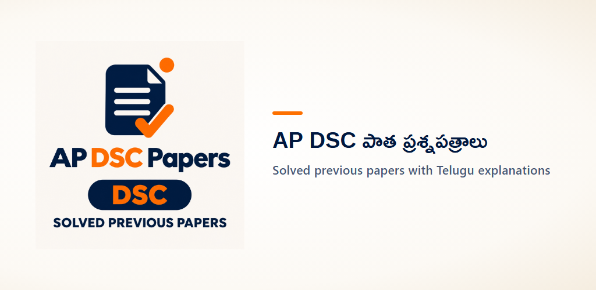
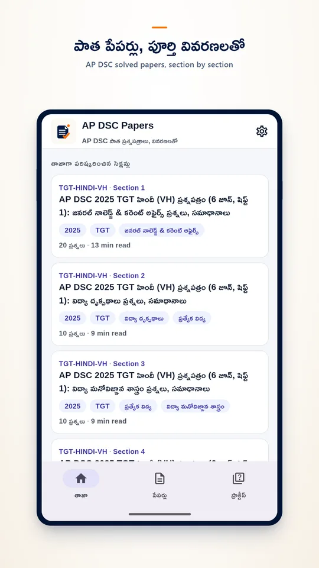
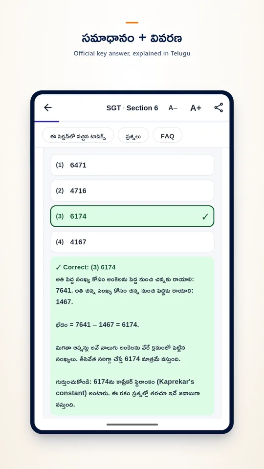
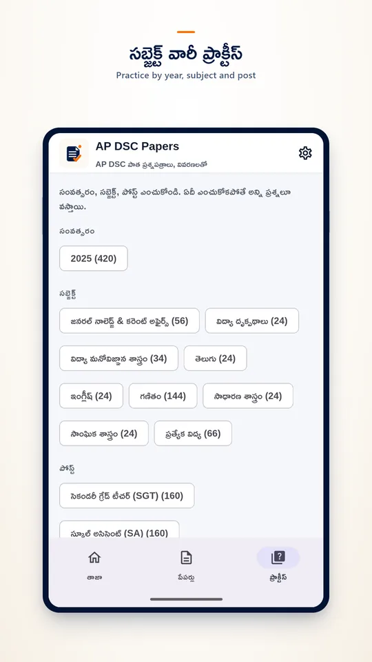
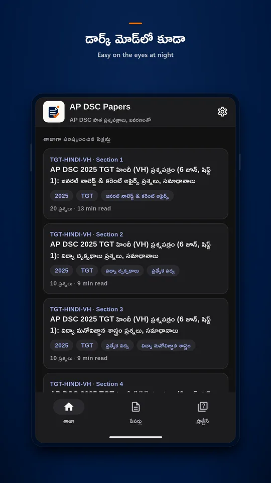

# AP DSC Previous Papers Telugu

AP DSC Papers is a free Android app with the AP DSC 2025 previous question papers solved one section at a time: the official final-key answer for every question and a clear explanation in Telugu.

<a href="https://play.google.com/store/apps/details?id=com.exambadi.apdscpapers&utm_source=github&utm_medium=readme"><b>Get it on Google Play</b></a> · <a href="https://apdsc.exambadi.in/">Website</a> · <a href="https://nookeshkarri7.github.io/apdsc-papers/">About page</a>

## What's inside

- **Three taps to a paper.** Pick your post, then the year, then the paper.
- **Real AP DSC papers.** SGT, School Assistant and TGT papers from the 2025 Mega DSC, listed by exam date and shift.
- **One section at a time.** GK and current affairs, perspectives in education, educational psychology, languages, maths, science, social studies, special education.
- **Questions as printed.** Telugu and English text with the four options, exactly as in the paper.
- **Official answers, explained.** Tap an option to check it; the correct answer comes from the department's final key, with a Telugu explanation and every maths step shown.
- **Practice by tag.** Filter questions by year, subject and post.
- **Works offline.** Sections you opened stay on your phone. Text size, light and dark themes, and an optional alert when new papers are solved.

Free, no sign-in. The app shows ads, never inside a question.

AP DSC Papers is an independent study app, not affiliated with the Government of Andhra Pradesh or the School Education Department.

## Links

- Google Play: https://play.google.com/store/apps/details?id=com.exambadi.apdscpapers
- Website: https://apdsc.exambadi.in/
- Privacy policy: https://apdsc.exambadi.in/app/privacy/
- Teaser: https://youtu.be/7Y9s0w_10Ho

© 2026 NK Tools
